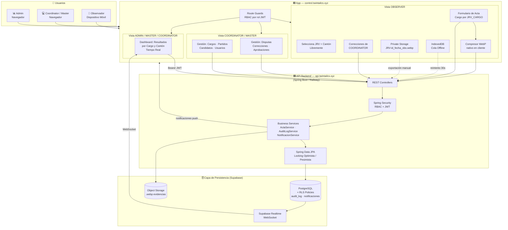

# Diagrama 01 — Arquitectura del Sistema (C4 Nivel 2)

Visión general de los componentes desacoplados del ecosistema electoral.

---

## Rutas por Rol

| Ruta | Rol requerido | Función |
|------|--------------|---------|
| `/login` | Público | Autenticación |
| `/observer/*` | OBSERVER | Registrar actas (selecciona JRV + Cantón), correcciones solicitadas |
| `/coordinator/*` | COORDINATOR · MASTER | Disputas, correcciones, aprobaciones |
| `/master/*` | MASTER | Cargos, partidos, candidatos, usuarios |
| `/dashboard/*` | ADMIN · MASTER · COORDINATOR | Resultados en tiempo real |
