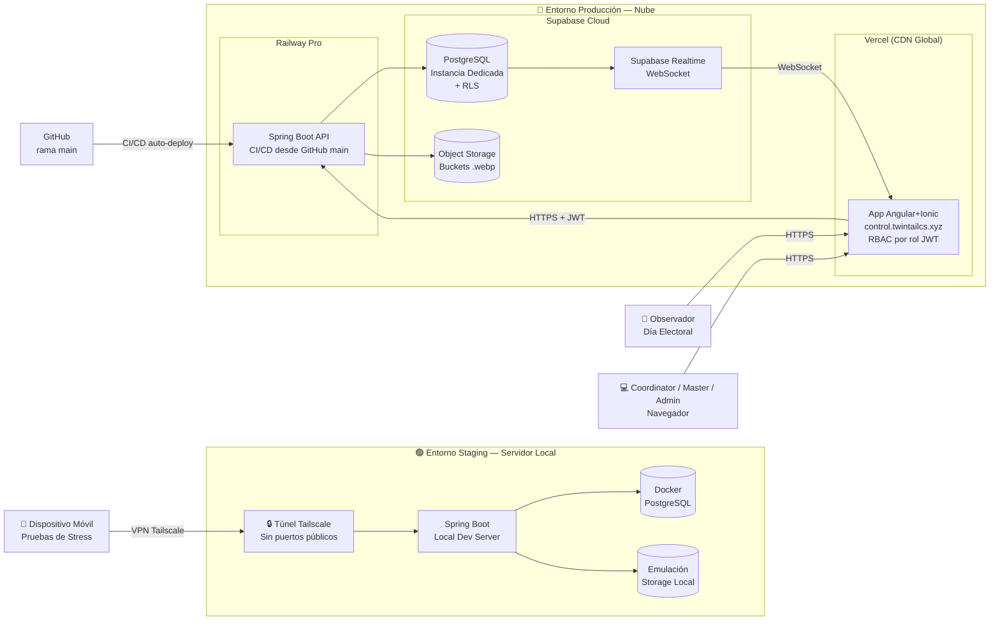

# Diagrama 02 — Topología de Despliegue (Staging vs Producción)

Dos entornos de red completamente diferenciados para QA y producción.

## Subdominios Producción

| Subdominio | Servicio | Roles | Proveedor |
|------------|---------|-------|-----------|
| `api.twintailcs.xyz` | API REST Spring Boot | Todos (con JWT) | Railway Pro |
| `control.twintailcs.xyz` | App Angular+Ionic — vistas por rol RBAC | MASTER · COORDINATOR · ADMIN · OBSERVER | Vercel |
