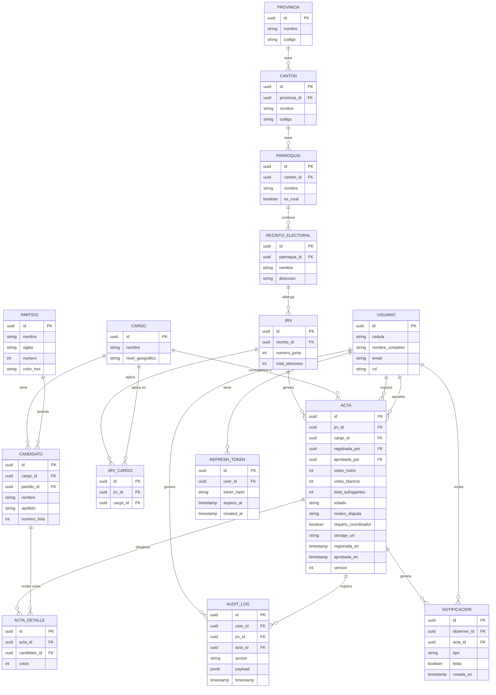

# Diagrama 05 — Modelo de Dominio Electoral

Entidades del negocio para las Elecciones Seccionales 2027-2031, Provincia de Santa Elena.



---

## Cargos — Elecciones Seccionales 2027-2031

| Cargo | Nivel Geográfico | Aplica en |
|-------|-----------------|-----------|
| Prefecto/a | `PROVINCIA` | Todas las JRVs |
| Consejero/a CPCCS | `NACIONAL` | Todas las JRVs |
| Alcalde/sa | `CANTON` | Todas las JRVs del cantón |
| Concejal Urbano | `CANTON` | JRVs en zonas urbanas |
| Concejal Rural | `CANTON` | JRVs en zonas rurales |
| Vocal Junta Parroquial Rural | `PARROQUIA` | JRVs en parroquias rurales únicamente |

> `JRV_CARGO` define qué cargos aplican para cada JRV según su ubicación geográfica.

---

## Regla de Validación por Acta

Cada acta corresponde a **un cargo**. La validación aplica de forma independiente por cargo:

```
SUM(acta_detalle.votos WHERE acta_id = ?) + votos_nulos + votos_blancos = total_sufragantes
```

---

## Estados del Acta

| Estado | Quién lo asigna | Descripción |
|--------|----------------|-------------|
| `BORRADOR` | OBSERVER | Formulario en edición, no enviado |
| `ENVIADA` | OBSERVER | Subida exitosa, pendiente revisión |
| `EN_DISPUTA` | COORDINATOR / MASTER | Foto no coincide con datos digitados |
| `CORREGIDA` | OBSERVER / COORDINATOR | Datos corregidos tras disputa |
| `APROBADA` | COORDINATOR / MASTER | Datos verificados y confirmados |
| `ANULADA` | MASTER | Fraude o irregularidad grave — estado final |

---

## Roles de Usuario

| Rol | Descripción |
|-----|-------------|
| `MASTER` | Acceso total — registra cargos, partidos, candidatos y puede anular actas |
| `COORDINATOR` | Global operativo — gestiona disputas, correcciones y aprobaciones |
| `ADMIN` | Global solo lectura — dashboard y estadísticas en tiempo real |
| `OBSERVER` | Registra actas (selecciona JRV + Cantón libremente) y las corrige si COORDINATOR lo solicita |

---

## Acciones de AUDIT_LOG

| Acción | Generada por |
|--------|-------------|
| `VALIDACION_FALLIDA` | OBSERVER — totales incorrectos rechazados por API |
| `STORAGE_REINTENTOS_AGOTADOS` | OBSERVER — upload imagen falló 3 veces |
| `ACTA_EN_DISPUTA` | COORDINATOR / MASTER |
| `ACTA_CORREGIDA_POR_OBSERVER` | OBSERVER |
| `ACTA_CORREGIDA_POR_COORDINATOR` | COORDINATOR |
| `ACTA_APROBADA` | COORDINATOR / MASTER |
| `ACTA_ANULADA` | MASTER |

---

## Tipos de NOTIFICACION

| Tipo | Receptor | Cuándo |
|------|----------|--------|
| `CORRECCION_REQUERIDA` | OBSERVER | COORDINATOR marca acta EN_DISPUTA |
| `ACTA_LISTA_PARA_REVISION` | COORDINATOR | OBSERVER corrige acta |
| `ACTA_ANULADA` | COORDINATOR | MASTER anula acta APROBADA |

---

## Cantones de Santa Elena

| Cantón | Código | JRV Estimadas |
|--------|--------|---------------|
| Santa Elena | 2401 | ~200 |
| La Libertad | 2402 | ~150 |
| Salinas | 2403 | ~100 |
