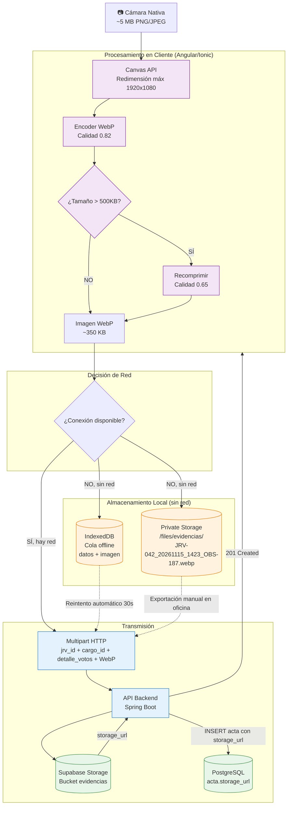

# Diagrama 06 — Pipeline de Optimización de Imágenes

Estrategia offline-first y compresión de evidencias fotográficas en el cliente.



---

## Reducción de Payload

| Etapa | Formato | Tamaño Típico | Ahorro |
|-------|---------|---------------|--------|
| Captura nativa | PNG/JPEG | ~5 MB | — |
| Tras compresión cliente (0.82) | WebP | ~350 KB | **93%** |
| Recompresión si excede 500KB (0.65) | WebP | ~300 KB | **94%** |
| Transmisión 3G/4G | WebP (multipart) | ~350 KB | ✅ Viable |

---

## Capas de Resiliencia Offline

| Capa | Almacenamiento | Propósito | Cuándo se limpia |
|------|---------------|-----------|-----------------|
| **1 — IndexedDB** | Cola en navegador | Reintento automático cada 30s | Al sincronizar exitosamente |
| **2 — Private Storage** | `/files/evidencias/` app | Fallback manual en oficina | Al sincronizar exitosamente |

## Formato de Nombre — Private Storage

```
JRV-{jrv_id}_{YYYYMMDD}_{HHmm}_{observer_id}.webp

Ejemplo: JRV-042_20261115_1423_OBS-187.webp
```

| Parte | Dato | Propósito |
|-------|------|-----------|
| `JRV-042` | jrv_id | Identifica mesa exacta |
| `20261115` | Fecha | Día de votación |
| `1423` | Hora local | Orden cronológico |
| `OBS-187` | observer_id | Quién capturó la evidencia |

> Directorio privado de la app — no accesible por otras apps, no requiere permisos especiales. La `storage_url` resultante se persiste directamente en `acta.storage_url` (no existe tabla EVIDENCIA separada).
