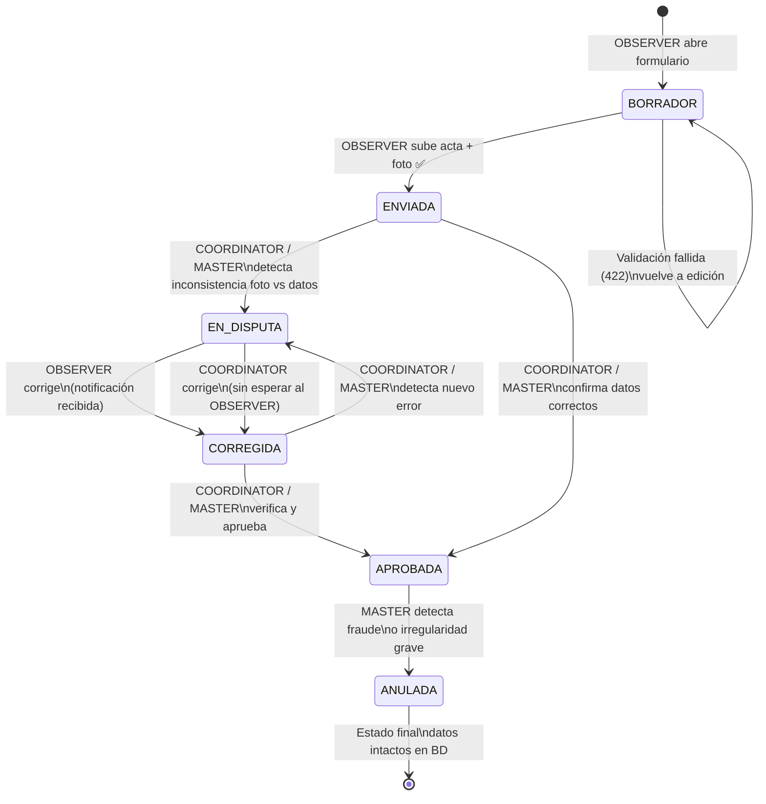

# Flujo 07b — Diagrama de Estados del Acta

Ciclo de vida completo de un acta desde su creación hasta su estado final.

---

## Transiciones Permitidas

| Desde | Hacia | Quién | Condición |
|-------|-------|-------|-----------|
| `BORRADOR` | `ENVIADA` | OBSERVER | Validación OK + foto WebP adjunta |
| `BORRADOR` | `BORRADOR` | OBSERVER | Validación fallida — vuelve a editar |
| `ENVIADA` | `EN_DISPUTA` | COORDINATOR · MASTER | Foto no coincide con datos digitados |
| `ENVIADA` | `APROBADA` | COORDINATOR · MASTER | Datos correctos — aprobación directa |
| `EN_DISPUTA` | `CORREGIDA` | OBSERVER · COORDINATOR | Corrección de datos realizada |
| `CORREGIDA` | `APROBADA` | COORDINATOR · MASTER | Corrección verificada |
| `CORREGIDA` | `EN_DISPUTA` | COORDINATOR · MASTER | Corrección insuficiente — nueva disputa |
| `APROBADA` | `ANULADA` | MASTER | Fraude o irregularidad grave detectada |

---

## Reglas Invariables

- `ANULADA` es estado final — ningún rol puede revertirlo.
- Datos e historial se conservan íntegros en PostgreSQL al anular.
- Actas `ANULADA` se excluyen de estadísticas del dashboard.
- Cada transición genera entrada en `audit_log`.
- Solo existe una acta por `jrv_id + cargo_id` — unicidad garantizada por locking pesimista.
