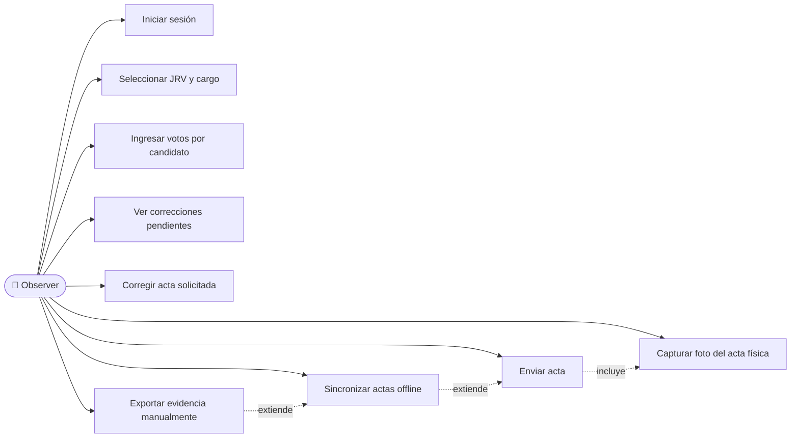
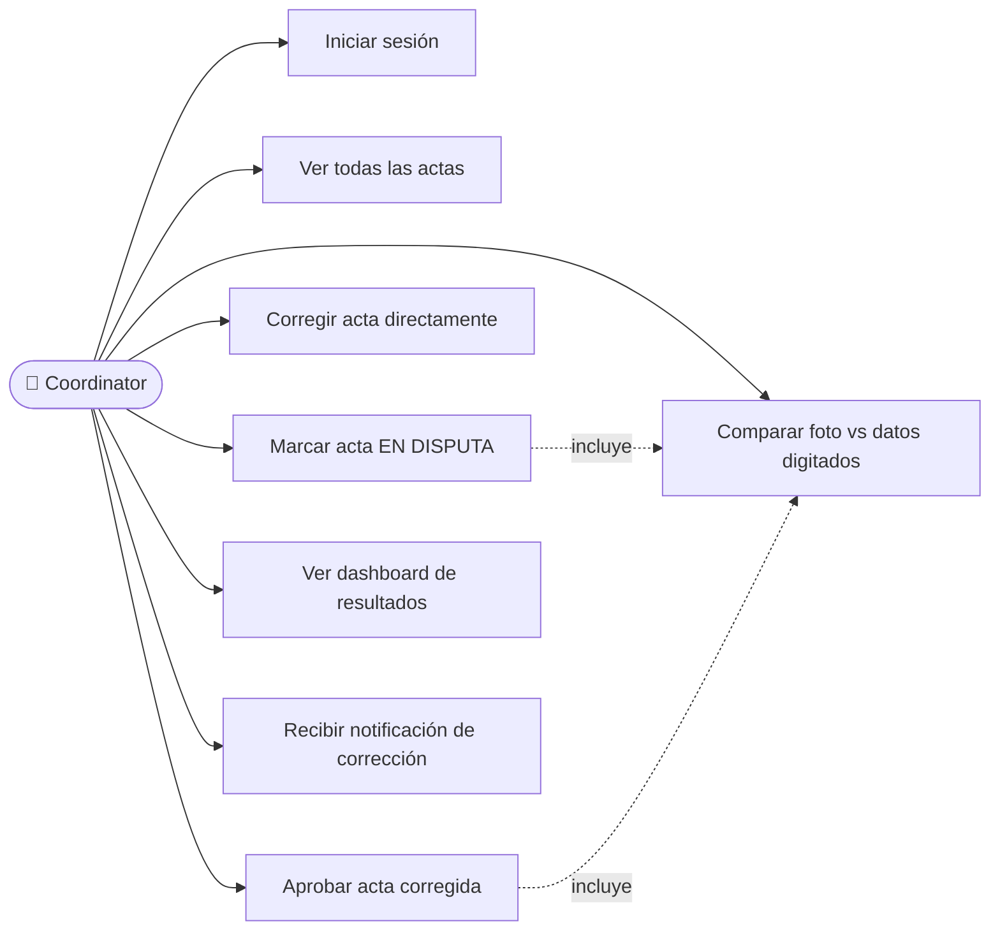
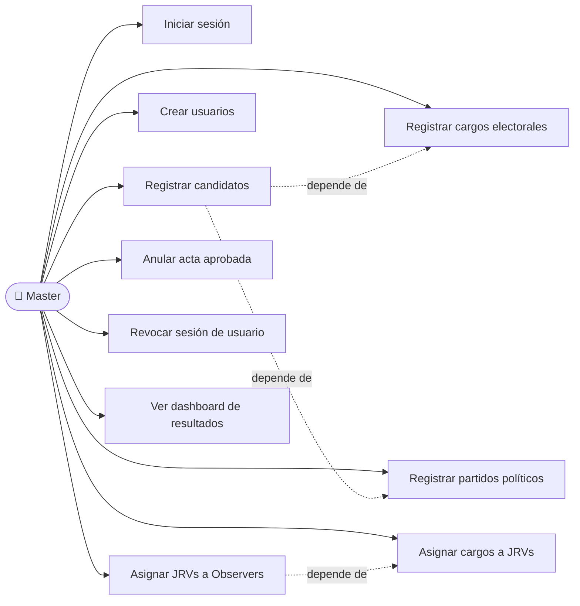
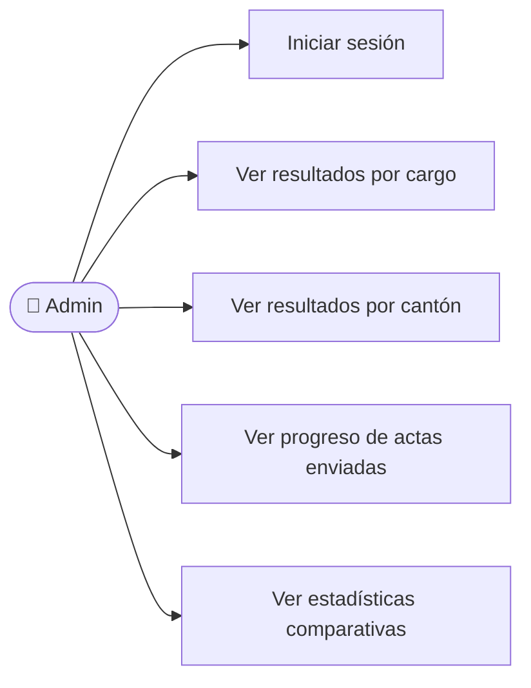

# Flujo 08b — Diagrama de Casos de Uso

Vista de alto nivel de las acciones disponibles por actor. Orientado a presentación con stakeholders no técnicos.

---

## OBSERVER

---

## COORDINATOR

---

## MASTER

---

## ADMIN

---

## Resumen por Actor

| Actor | Escribe datos | Gestiona usuarios | Ve resultados | Aprueba / Anula |
|-------|:---:|:---:|:---:|:---:|
| OBSERVER | ✅ sus JRVs | ❌ | ❌ | ❌ |
| COORDINATOR | ✅ correcciones | ❌ | ✅ | ✅ aprueba |
| MASTER | ✅ configuración | ✅ | ✅ | ✅ anula |
| ADMIN | ❌ | ❌ | ✅ | ❌ |
