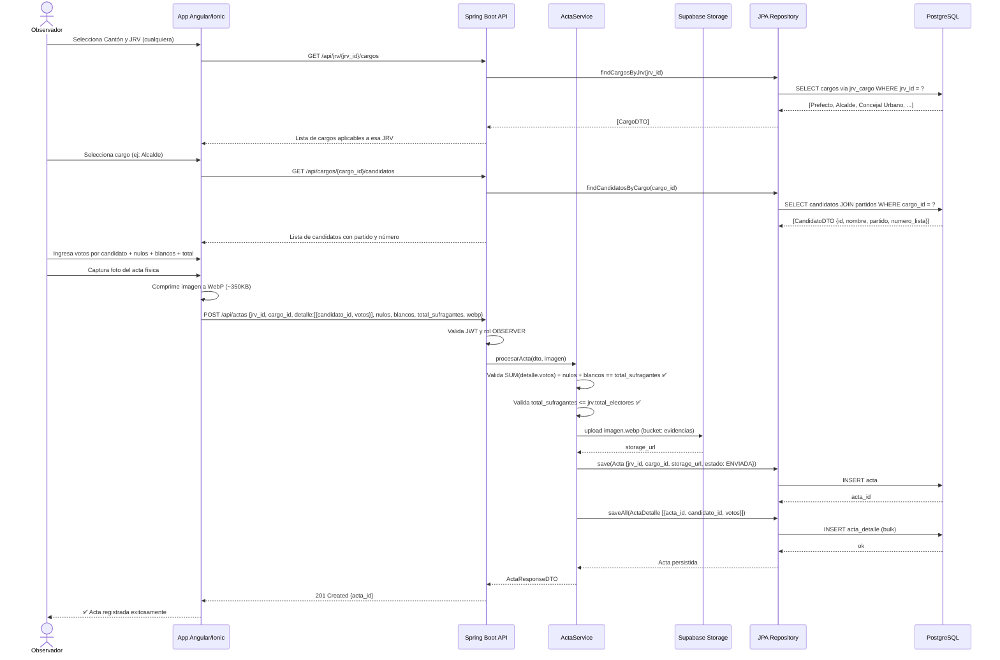

# Flujo 01 — Registro de Acta Exitoso (Happy Path Online)

**Estado:** ⏳ PLANEADO — Código backend aún no implementado. Ver [diagram/README.md](../README.md).

Escenario nominal: observador con conexión activa registra su acta correctamente.

