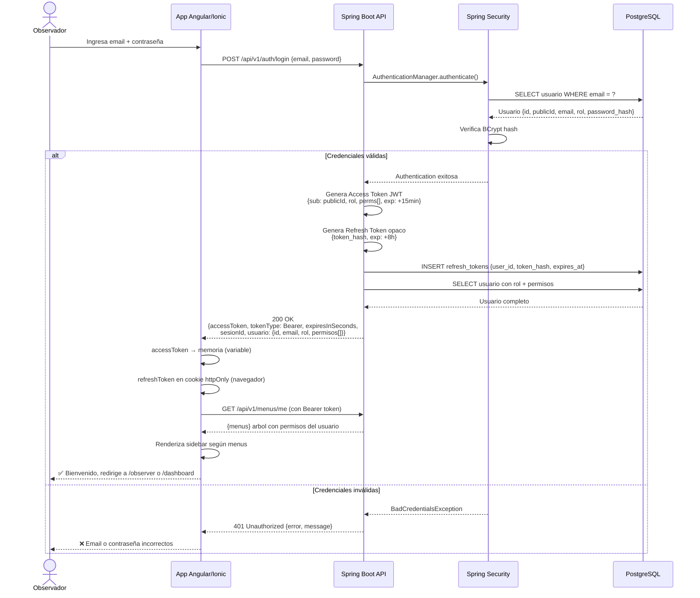

# Flujo 03 — Autenticación del Observador (Login)

Escenario: observador ingresa credenciales y obtiene access token + refresh token.

Access token: corto plazo (15 min), JWT stateless.
Refresh token: largo plazo (8h — duración del proceso electoral), opaco, persistido en DB para revocación.

## Notas de Seguridad

| Token | Almacenamiento | Duración | Seguridad |
|---|---|---|---|
| Access Token (JWT) | Memoria JS (no localStorage) | 15 min | Stateless. Expira rápido. Si robado → ventana mínima. |
| Refresh Token (opaco) | Cookie httpOnly + Secure + SameSite=Strict | 8h (proceso electoral) | No accesible desde JS (secure contra XSS). Revocable en DB. |

**RBAC a dos niveles:**
1. **JWT claim "perms":** lista de permisos en accesToken (rápido, usado en @PreAuthorize)
2. **GET /api/v1/menus/me:** arbol de menus visibles según permisos (RenderUI en FE)
