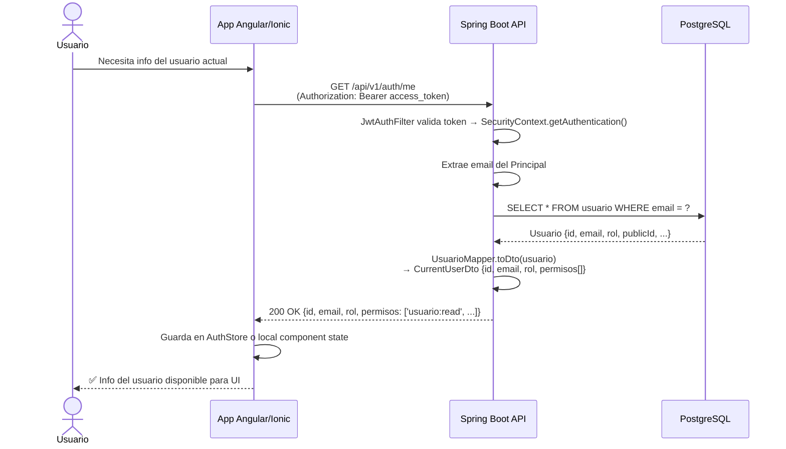

# Flujo 03.2 — Obtener Datos Usuario Actual (GET /api/v1/auth/me)

Escenario: FE obtiene información del usuario autenticado (parseado desde JWT en SecurityContext).



---

## Response DTO

```typescript
// CurrentUserDto (frontend/app/src/app/core/auth/data/auth.dto.ts)
{
  id: number;           // PK interno de PostgreSQL
  email: string;        // Email único
  rol: string;          // 'MASTER' | 'COORDINATOR' | 'ADMIN' | 'OBSERVER'
  permisos: string[];   // ['usuario:read', 'acta:approve', ...] (basado en rol + rol_permiso)
}
```

---

## Casos de Uso

1. **Verificar identidad post-login**
2. **Mostrar perfil del usuario** (email, rol) en UI
3. **Validar permisos en FE** antes de mostrar opciones
4. **Refrescar datos usuario** después de cambios de admin

