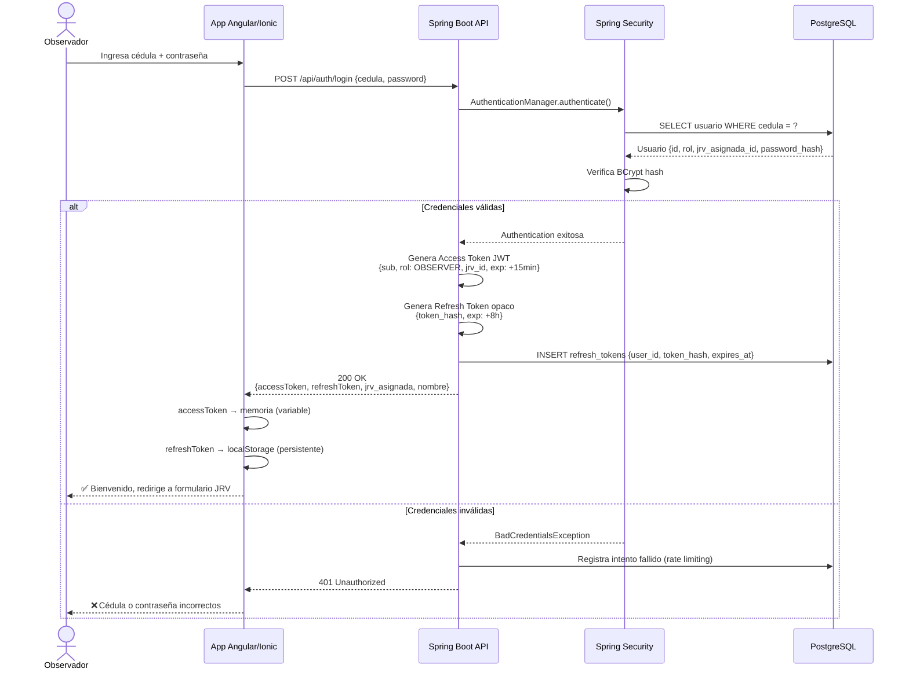

# Flujo 03 — Autenticación del Observador (Login)

Escenario: observador ingresa credenciales y obtiene access token + refresh token.

Access token: corto plazo (15 min), JWT stateless.
Refresh token: largo plazo (8h — duración del proceso electoral), opaco, persistido en DB para revocación.

## Notas de Seguridad

| Token | Almacenamiento | Duración | Por qué |
|---|---|---|---|
| Access Token (JWT) | Memoria JS (no localStorage) | 15 min | Si robado, ventana mínima de daño |
| Refresh Token (opaco) | localStorage | 8h (proceso electoral) | Revocable desde DB si se detecta anomalía |
