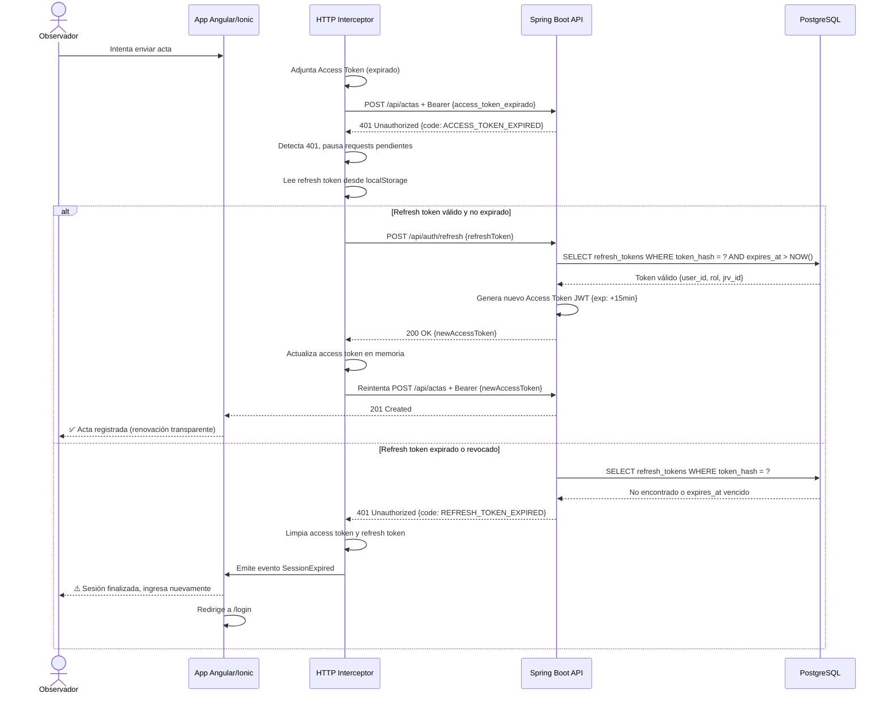
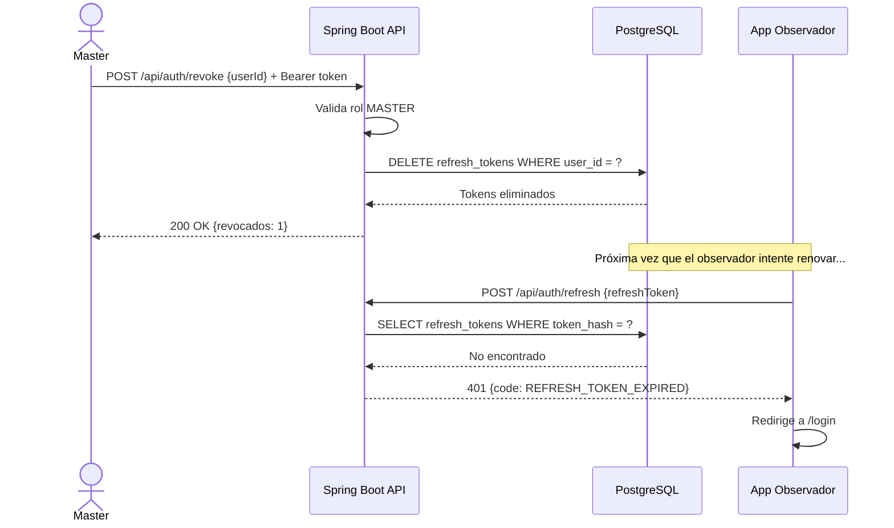

# Flujo 04 — Access Token Expirado: Renovación con Refresh Token

Escenario: access token vence cada 15 min; el interceptor lo renueva transparentemente sin interrumpir al observador.

## Flujo 04b — Revocación Manual (Logout o Anomalía Detectada)

