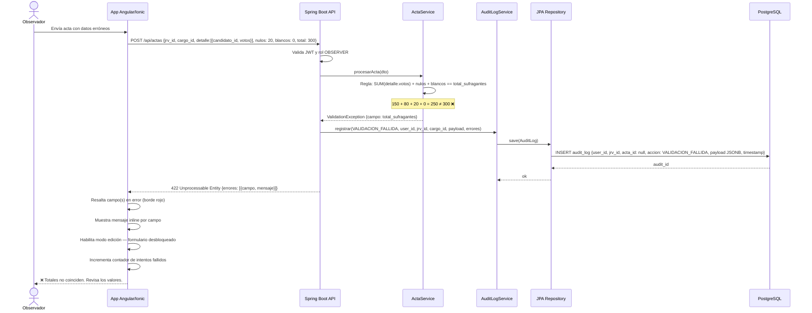
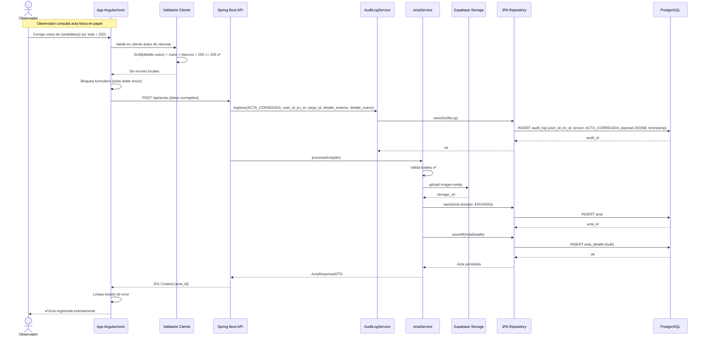
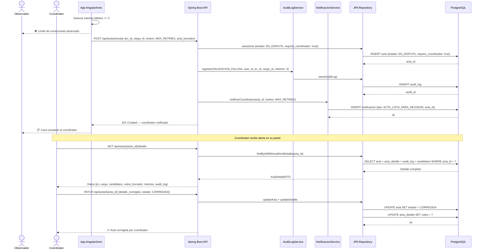

# Flujo 05 — Validación de Acta Fallida y Corrección

---

## Parte A — Envío y Rechazo por Validación

Escenario: backend rechaza acta por totales incorrectos y habilita modo edición.

---

## Parte B — Corrección Exitosa (intentos < 3)

Escenario: observador consulta acta física, corrige el valor, pasa validación cliente y reenvía.

---

## Parte C — Escalación al Coordinator (intentos >= 3)

Escenario: observador agota intentos sin corregir correctamente; caso escala al coordinator.

---

## Reglas de Validación del Acta

| Regla | Fórmula | Error |
|---|---|---|
| Suma de votos | `SUM(acta_detalle.votos) + nulos + blancos = total_sufragantes` | 422 campo: total_sufragantes |
| Total no excede padrón | `total_sufragantes <= jrv.total_electores` | 422 campo: total_sufragantes |
| Candidatos obligatorios | Todos los candidatos del cargo con valor >= 0 | 422 campo: candidato_{id} |
| Evidencia obligatoria | Imagen WebP requerida | 422 campo: evidencia |

## Notas de Auditoría

`AuditLog` es tabla en PostgreSQL. Flujo: `AuditLogService → JPA Repository → PostgreSQL`.

| Acción | Cuándo | payload JSONB contiene |
|--------|--------|------------------------|
| `VALIDACION_FALLIDA` | Rechazo 422 | cargo_id, detalle enviado, errores[] |
| `ACTA_CORREGIDA` | Reenvío exitoso | cargo_id, detalle_anterior, detalle_nuevo |

> Registrar fallos permite detectar patrones sospechosos (múltiples intentos con valores distintos en misma JRV/cargo) y provee trazabilidad forense completa ante disputas.
