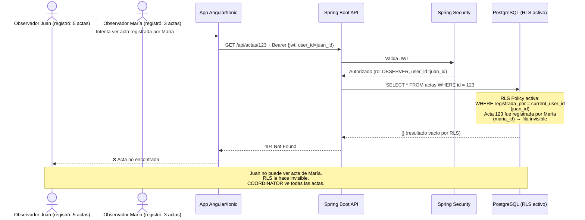

# Flujo 07 — Acceso Denegado por RLS (Acta de Otro OBSERVER)

**Estado:** ⏳ PLANEADO — Código backend aún no implementado. Ver [diagram/README.md](../README.md).

Escenario: un OBSERVER intenta acceder a acta registrada por otro OBSERVER.

