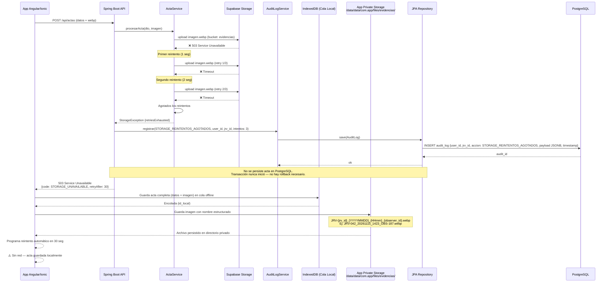
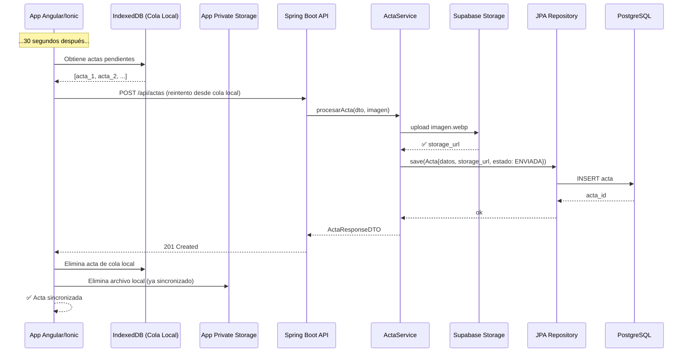
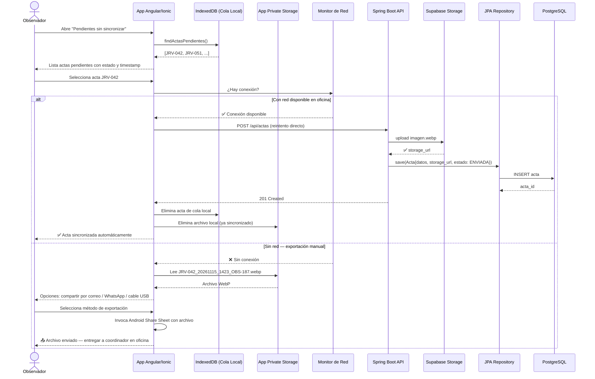

# Flujo 10 — Error al Subir Imagen a Storage (Compensación)

Escenario: el upload de la evidencia falla; el sistema compensa para no dejar datos huérfanos.

---

## Parte A — Fallo de Upload y Guardado Local



---

## Parte B — Reintento Automático Exitoso (corte breve)



---

## Parte C — Exportación Manual en Oficina (corte prolongado)

Escenario: reintento automático nunca logró conectar (corte prolongado). OBSERVER llega a oficina y exporta evidencia manualmente.



---

## Capas de Resiliencia

```
Upload falla 3 veces
    ├── Capa 1: IndexedDB      → reintento automático cada 30s (cortes breves)
    └── Capa 2: Storage privado → fallback manual en oficina (cortes prolongados)
                 └── nombre: JRV-{jrv_id}_{YYYYMMDD}_{HHmm}_{observer_id}.webp
```

## Formato de Nombre de Archivo

```
JRV-{jrv_id}_{YYYYMMDD}_{HHmm}_{observer_id}.webp

Ejemplo: JRV-042_20261115_1423_OBS-187.webp
```

| Parte | Dato | Propósito |
|-------|------|-----------|
| `JRV-042` | jrv_id | Identifica mesa exacta |
| `20261115` | Fecha | Día de votación |
| `1423` | Hora local | Orden cronológico |
| `OBS-187` | observer_id | Quién capturó la evidencia |

## Notas

- Archivos guardados en directorio privado de la app — no accesibles por otras apps, no requieren permisos especiales.
- Al sincronizar exitosamente (Parte B o C con red), el archivo local se elimina automáticamente.
- La exportación manual solo se ofrece cuando no hay red disponible en el momento del intento.
