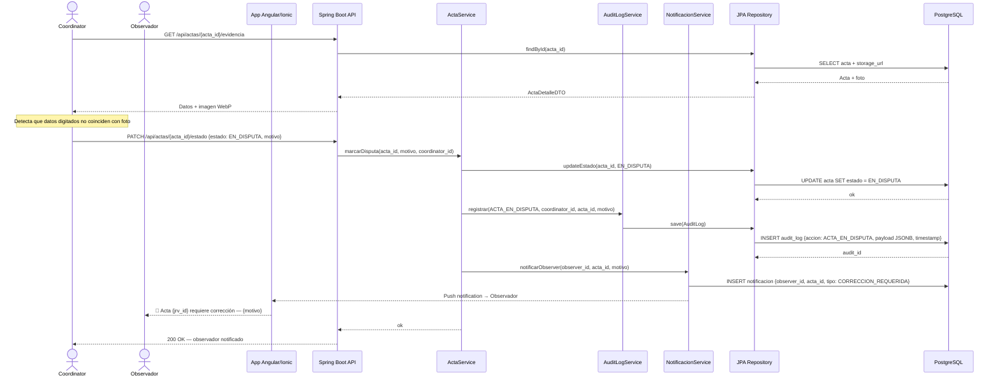
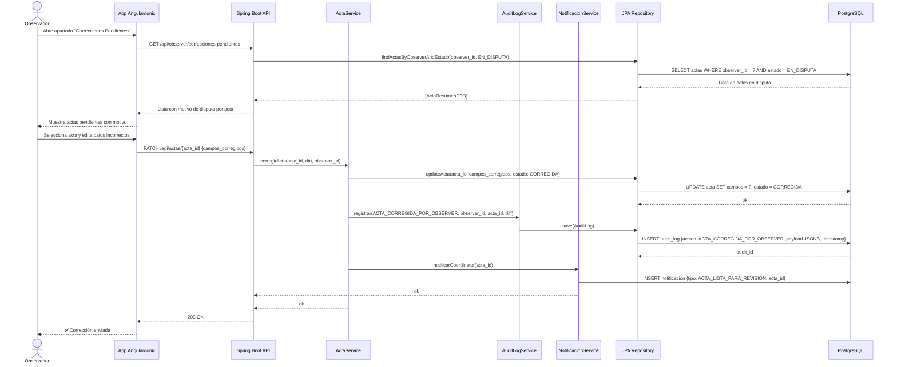
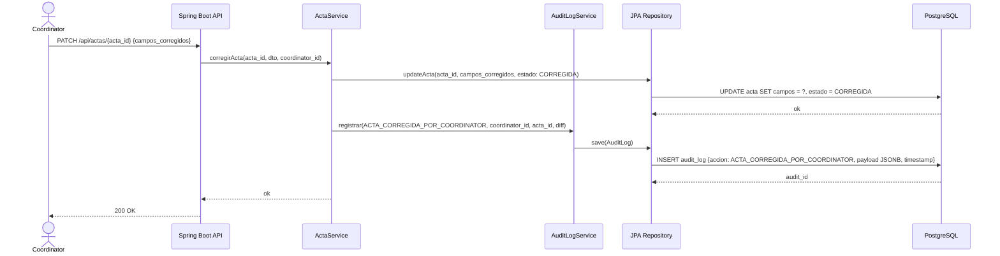
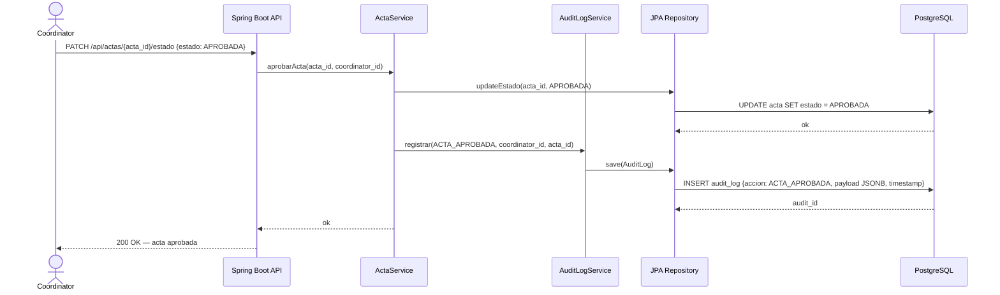

# Flujo 11 — Disputa de Acta y Corrección

n**Estado:** ⏳ PLANEADO — Código backend aún no implementado. Ver [diagram/README.md](../README.md).
---

## Parte A — COORDINATOR marca acta EN_DISPUTA

Escenario: COORDINATOR detecta inconsistencia entre foto y datos digitados; notifica al OBSERVER para corregir.



---

## Parte B — OBSERVER corrige acta EN_DISPUTA

Escenario: OBSERVER recibe notificación, abre el apartado de correcciones pendientes y edita los datos.



---

## Parte C — COORDINATOR corrige acta directamente

Escenario: OBSERVER no puede corregir en ese momento; COORDINATOR edita directamente sin esperar.



---

## Parte D — COORDINATOR aprueba acta CORREGIDA

Escenario: COORDINATOR revisa corrección (de OBSERVER o propia) y aprueba el acta.



---

## Estados del Acta

```
BORRADOR → ENVIADA → EN_DISPUTA → CORREGIDA → APROBADA
```

| Transición | Quién |
|------------|-------|
| `BORRADOR → ENVIADA` | OBSERVER |
| `ENVIADA → EN_DISPUTA` | COORDINATOR / MASTER |
| `EN_DISPUTA → CORREGIDA` | OBSERVER o COORDINATOR (sin tiempo de espera) |
| `CORREGIDA → APROBADA` | COORDINATOR / MASTER |

## Notas de Auditoría

| Acción | Quién | payload JSONB contiene |
|--------|-------|------------------------|
| `ACTA_EN_DISPUTA` | COORDINATOR | motivo, coordinator_id |
| `ACTA_CORREGIDA_POR_OBSERVER` | OBSERVER | campos cambiados, valor_anterior, valor_nuevo |
| `ACTA_CORREGIDA_POR_COORDINATOR` | COORDINATOR | campos cambiados, valor_anterior, valor_nuevo |
| `ACTA_APROBADA` | COORDINATOR | coordinator_id, timestamp |
