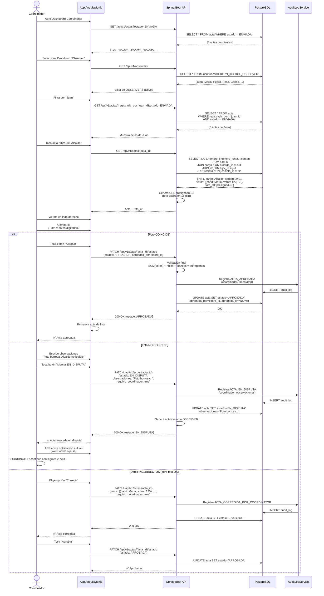

# Flujo 11 — Revisión de Actas por COORDINATOR

**Estado:** ⏳ PLANEADO — Flujo principal de validación. Código backend aún no implementado.

Escenario: COORDINATOR revisa actas subidas por OBSERVERS, filtra por usuario y valida contra foto.



---

## Validaciones en API

```java
// Antes de APROBAR:
if (!sumVotosCorrectos(acta)) {
    throw new ValidationException("Totales no coinciden");
}

// Validar que cargo aplica a JRV:
if (!jrvCargoRepository.existsByJrvIdAndCargoId(
    acta.jrvId, acta.cargoId)) {
    throw new InvalidCombinationException("Cargo no aplica");
}

// Transición de estado válida:
if (acta.estado != ActaEstado.ENVIADA && 
    acta.estado != ActaEstado.CORREGIDA) {
    throw new InvalidStateException("No se puede aprobar desde " + acta.estado);
}
```

---

## Estados Posibles de Acta

```
ENVIADA          → APROBADA (si está OK)
                 → EN_DISPUTA (si foto ≠ datos)
                 → CORREGIDA (si COORDINATOR corrige)

EN_DISPUTA       → CORREGIDA (OBSERVER o COORDINATOR corrige)
                 → APROBADA (si se resuelve)

CORREGIDA        → APROBADA (validación final)
                 → EN_DISPUTA (si sigue mal)

APROBADA         → ANULADA (solo MASTER, por fraude)
```

---

## Endpoints Necesarios

| Método | Endpoint | Descripción |
|--------|----------|-------------|
| `GET` | `/api/v1/actas?estado=ENVIADA` | Listar pendientes |
| `GET` | `/api/v1/actas?registrada_por={id}` | Filtrar por OBSERVER |
| `GET` | `/api/v1/observers` | Listar OBSERVERS activos |
| `GET` | `/api/v1/actas/{id}` | Detalle + foto presignada |
| `PATCH` | `/api/v1/actas/{id}/estado` | Cambiar estado |
| `PATCH` | `/api/v1/actas/{id}` | Corregir datos |

---

## Notas de Seguridad

- JWT claim `rol` = COORDINATOR
- @PreAuthorize("hasAuthority('acta:aprobar')")
- RLS: COORDINATOR ve todas las actas (sin restricción)
- Foto: S3 URL presignada (expira en 15 min, secure)
- Audit: Toda acción registrada en audit_log

