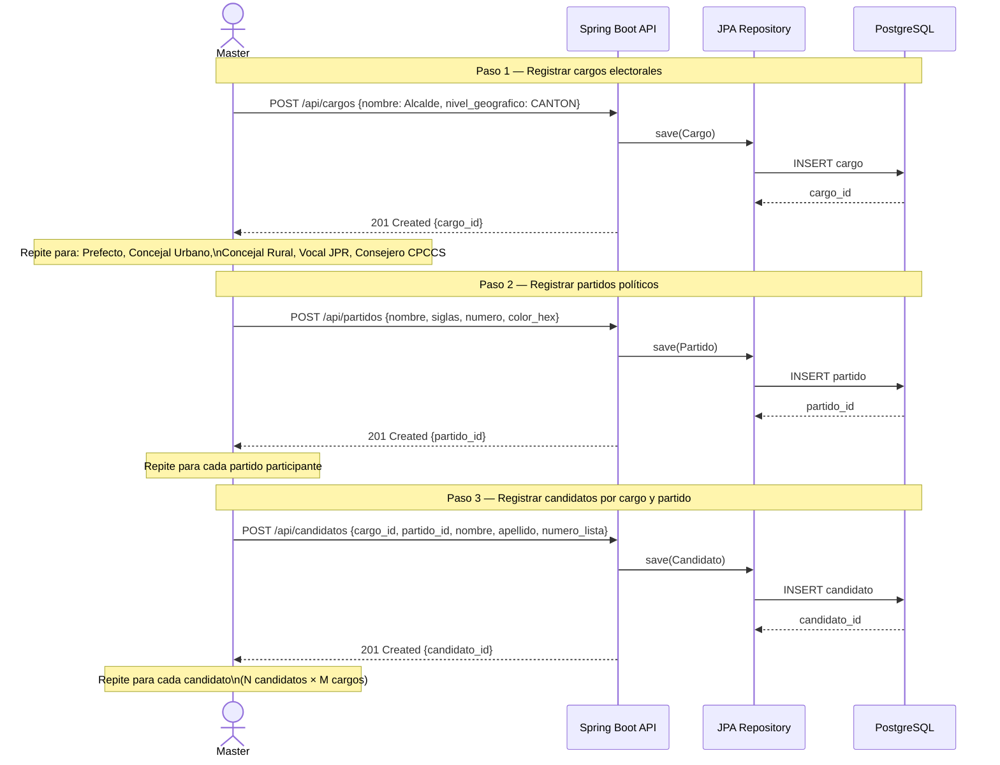
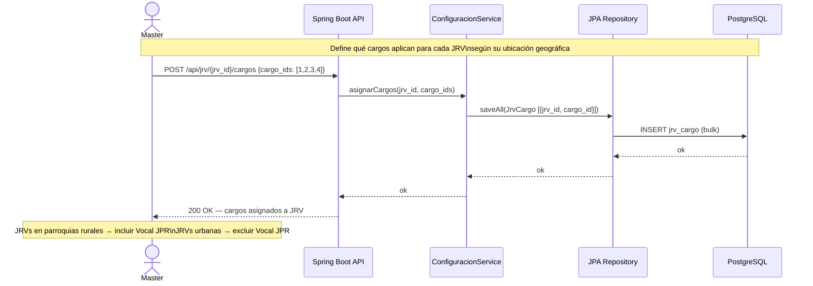
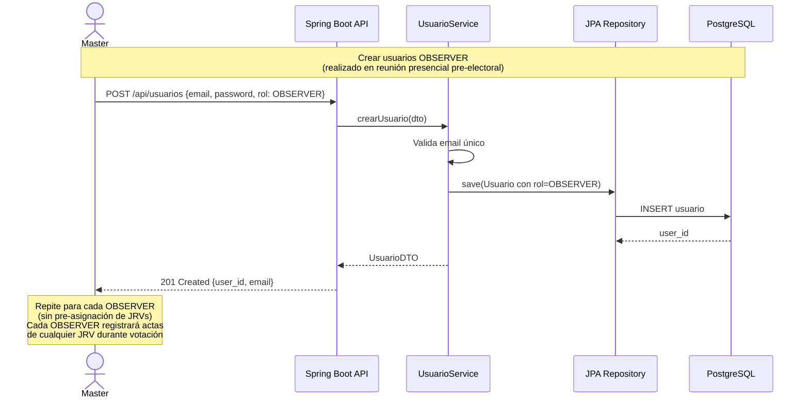

# Flujo 13 — Configuración Pre-Electoral (MASTER)

n**Estado:** ⏳ PLANEADO — Código backend aún no implementado. Ver [diagram/README.md](../README.md).
Escenario: MASTER registra toda la información necesaria antes del día de votación.

---

## Parte A — Registro de Cargos, Partidos y Candidatos



---

## Parte B — Asignación de Cargos por JRV



---

## Parte C — Creación de Usuarios OBSERVER



---

## Checklist Pre-Electoral (orden obligatorio)

```
1. Registrar cargos electorales
2. Registrar partidos políticos
3. Registrar candidatos por cargo y partido
4. Asignar cargos a cada JRV según geografía (JRV_CARGO)
5. Crear usuarios OBSERVER
```

> El orden importa: candidatos dependen de cargos y partidos. JRV_CARGO debe estar poblada antes de que OBSERVERS registren actas.
