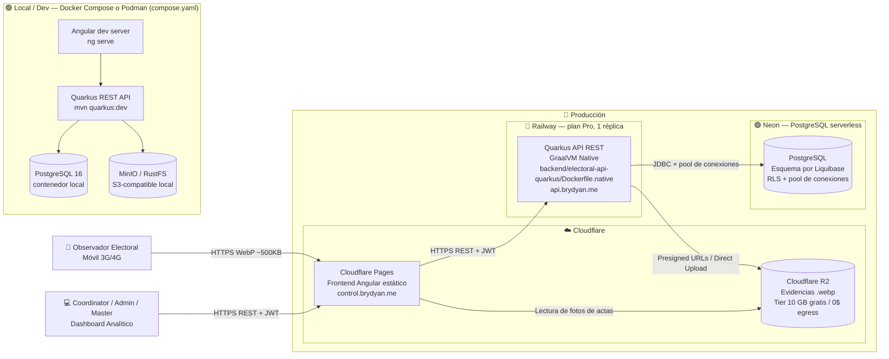

# Diagrama 02 — Topología de Despliegue (Local, Producción y Backup)

Topología de despliegue vigente: backend Quarkus en Railway, frontend Angular en Cloudflare Pages, PostgreSQL en Neon y evidencias en Cloudflare R2.

---

## Estrategia de Infraestructura

| Componente | Plataforma | Rol en Elección | Costo |
|---|---|---|---|
| **Frontend** | Cloudflare Pages | Distribución global de estáticos Angular. Inmune a picos de tráfico. | **$0.00** |
| **Storage Actas** | Cloudflare R2 | Almacenamiento de actas optimizadas (~500 KB). 10 GB gratis al mes, 0$ egress. | **$0.00** (< 3 GB para ~4,000 actas) |
| **API Backend** | Railway (plan Pro, 1 réplica) | Procesamiento transaccional de actas y autenticación RBAC con Quarkus. Build vía `railway.json` + `Dockerfile.native`. | Por verificar (plan Pro) |
| **Base de Datos** | Neon (PostgreSQL serverless) | Única fuente de verdad electoral, RLS y exclusión de anuladas. Esquema propiedad de Liquibase. | Por verificar (tier free / pago) |
| **Backup / Recuperación** | Neon (snapshots automáticos + PITR) | Restauración a punto en el tiempo de la base electoral. | Incluido en el plan de Neon |

---

## Notas de la topología

- **Despliegue del backend:** Railway toma `railway.json` (builder `dockerfile`, `backend/electoral-api-quarkus/Dockerfile.native`). La API responde en `api.brydyan.me`.
- **Despliegue del frontend:** Cloudflare Pages sirve el build estático de Angular en `control.brydyan.me`. Ver `CLOUDFLARE_PAGES_SETUP.md`.
- **Variables de entorno:** las de producción se configuran en Railway y en Cloudflare Pages; `.env.example` es la única plantilla compartida.
- **Entorno local:** `compose.yaml` levanta PostgreSQL y el storage S3-compatible local (MinIO / RustFS).
- **Staging:** no hay un destino de staging cloud confirmado; por ahora se resuelve con `compose.yaml` en local y acceso por Tailscale.
- **`k8s/`:** el directorio conserva manifiestos de Kubernetes de referencia/legado. **No es el destino de producción** y no se usa como vía de rollout.
