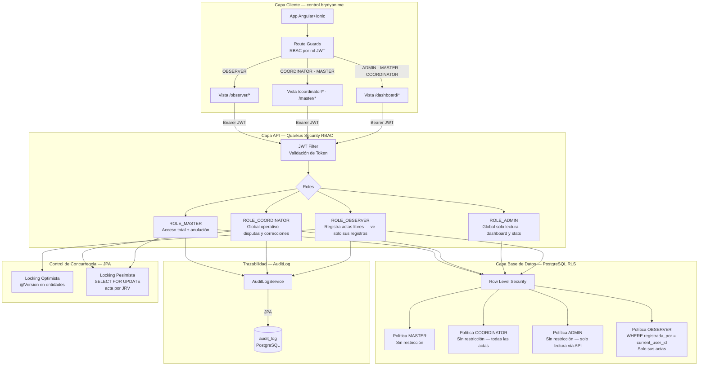

# Diagrama 04 — Modelo de Seguridad y Control de Acceso

Capas de seguridad desde la app hasta la base de datos.

---

## Matriz de Permisos

| Acción | MASTER | COORDINATOR | ADMIN | OBSERVER |
|--------|--------|-------------|-------|----------|
| Gestionar usuarios y configuración | ✅ | ❌ | ❌ | ❌ |
| Registrar cargos, partidos y candidatos | ✅ | ❌ | ❌ | ❌ |
| Ver todas las actas | ✅ | ✅ | ✅ APROBADAS | ✅ sus registros |
| Registrar acta | ❌ | ❌ | ❌ | ✅ cualquier JRV |
| Ver evidencias (fotos) | ✅ | ✅ | ✅ | ✅ sus registros |
| Marcar acta EN_DISPUTA | ✅ | ✅ | ❌ | ❌ |
| Corregir acta | ✅ | ✅ | ❌ | ✅ si se le solicita |
| Aprobar acta | ✅ | ✅ | ❌ | ❌ |
| Anular acta APROBADA | ✅ | ❌ | ❌ | ❌ |
| Revocar tokens de sesión | ✅ | ❌ | ❌ | ❌ |
| Ver dashboard y estadísticas | ✅ | ✅ | ✅ | ❌ |
| Recibir notificación de corrección | ❌ | ❌ | ❌ | ✅ |

> La fuente de verdad de los permisos atómicos es el seed de Liquibase
> (`002-rbac-seed.sql`, `008-configuracion.sql`, `009-acta-observer-permisos.sql`).

### Endpoint → permiso y rate limit

Matriz por endpoint (guardrail: todo endpoint declara sus roles). Se completa a
medida que se tocan endpoints; hoy cubre los del rate limiting (sc-521).

| Endpoint | Permiso exigido | Roles con ese permiso (seed) | Rate limit |
|---|---|---|---|
| `POST /api/v1/auth/login` | público | — | `login-ip` + `login-account(-ip)` |
| `PUT /api/v1/user/update-personal-email` | autenticado | todos | `reauth` |
| `POST /api/v1/legal/contact-dpo` | público | — | `contact-dpo` |
| `GET /api/v1/observer/jrvs` | `acta:read` | OBSERVER, COORDINATOR, ADMIN, MASTER | `observer-jrvs` |
| `GET /api/v1/observer/jrv/{id}/cargos` | `acta:read` | OBSERVER, COORDINATOR, ADMIN, MASTER | `observer-jrvs` |
| `POST /api/v1/observer/actas` | `acta:upload` | OBSERVER, MASTER | `observer-actas` |
| `GET /api/v1/configuracion/{cargos,partidos,candidatos}` | autenticado | todos | `config-read` |
| `GET /api/v1/admin/usuarios` | `usuario:read` o MASTER | MASTER, COORDINATOR, ADMIN | `admin-usuarios` |
| cualquier endpoint autenticado | — | — | `user-global` |

Pendiente de decisión: el seed da `acta:upload` a MASTER, pero la matriz de
arriba dice "Registrar acta: MASTER ❌".

---

## Políticas RLS

| Rol | Política | Alcance |
|-----|----------|---------|
| `MASTER` | Sin restricción | Todas las filas |
| `COORDINATOR` | Sin restricción | Todas las filas |
| `ADMIN` | Sin restricción | Todas las filas (lectura forzada en capa API) |
| `OBSERVER` | `WHERE registrada_por = current_user_id` | Solo sus actas registradas |

---

## Acciones Auditadas

| Acción | Quién la genera |
|--------|----------------|
| `VALIDACION_FALLIDA` | OBSERVER — totales incorrectos rechazados |
| `STORAGE_REINTENTOS_AGOTADOS` | OBSERVER — upload imagen falló 3 veces |
| `ACTA_EN_DISPUTA` | COORDINATOR / MASTER |
| `ACTA_CORREGIDA_POR_OBSERVER` | OBSERVER |
| `ACTA_CORREGIDA_POR_COORDINATOR` | COORDINATOR |
| `ACTA_APROBADA` | COORDINATOR / MASTER |
| `ACTA_ANULADA` | MASTER |
