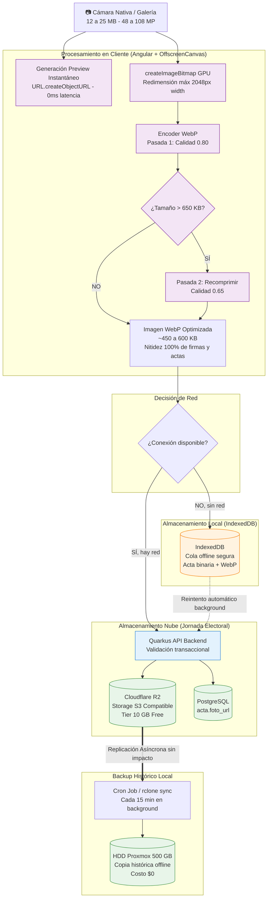

# Diagrama 06 — Pipeline de Optimización de Imágenes y Almacenamiento

Estrategia offline-first, compresión adaptativa para celulares modernos (48-108 MP) y replicación asíncrona hacia servidor local.

---

## Métricas de Reducción de Payload

| Etapa | Formato | Dimensión | Peso Típico | Ahorro |
|---|---|---|---|---|
| Captura móvil moderna (48-108 MP) | JPEG / HEIC original | 8000x6000 | ~15 MB a 25 MB | — |
| Pre-scale GPU + WebP (0.80) | WebP | 2048px max | ~500 KB | **96% - 98%** |
| Recompresión si > 650KB (0.65) | WebP | 2048px max | ~450 KB | **97% - 98%** |
| Transmisión móvil 3G/4G | WebP binario | 2048px | ~500 KB | ✅ Subida en 1-2s |

---

## Capacidad de Almacenamiento Electoral (Provincia Santa Elena)

- **Total actas estimadas**: ~4,000 actas (800 JRVs × 4 dignidades + margen de disputas).
- **Consumo total estimado en Cloudflare R2**: $4{,}000 \times 0.5\text{ MB} = \mathbf{2.0\text{ GB}}$.
- **Tier Gratuito Cloudflare R2**: 10.0 GB/mes (Cubre el 100% de la elección a costo $0.00).
- **Copia Local HDD Proxmox**: 2.0 GB respaldados silenciosamente en tu disco de 500 GB.
