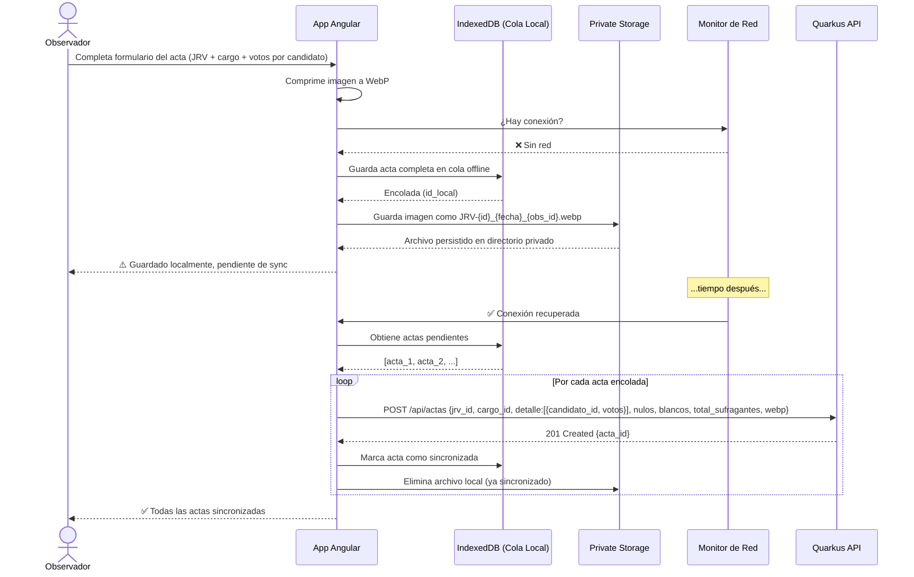

# Flujo 02 — Registro Offline y Sincronización al Reconectar

n**Estado:** ⏳ PLANEADO — Código backend aún no implementado. Ver [diagram/README.md](../README.md).
Escenario: observador sin cobertura de red guarda el acta localmente y la sincroniza al recuperar conexión.

