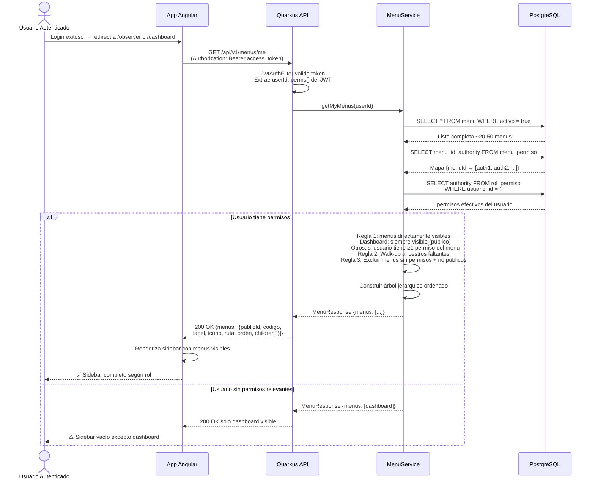

# Flujo 03.1 — Construcción de Sidebar RBAC (GET /api/v1/menus/me)

Escenario: Post-login, FE obtiene arbol de menus visibles según los permisos del usuario.

---

## Reglas de Visibilidad de Menus

| Regla | Descripción |
|-------|-------------|
| **Público** | Menu código en `['dashboard']` → siempre visible (no requiere permiso) |
| **Permiso requerido** | Menu tiene ≥1 `menu_permiso` → usuario debe tener ≥1 permiso match (OR) |
| **Sin permiso + no público** | Menu excluido aunque sea hijo de padre visible |
| **Walk-up** | Ancestros de menus visibles incluidos siempre (mantiene estructura visual) |

---

## Cardinalidad

- **Menus totales:** ~20-50
- **Cargados en memoria:** Sí (toda el catalogo, filtrado post-query)
- **Típica complejidad O(n):** Dos passes (directo + walk-up)

