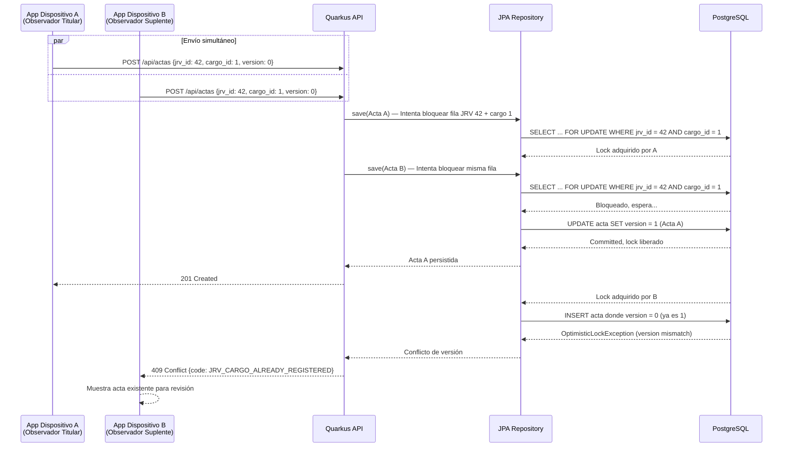

# Flujo 06 — Conflicto de Concurrencia en la Misma JRV y Cargo

n**Estado:** ⏳ PLANEADO — Código backend aún no implementado. Ver [diagram/README.md](../README.md).
Escenario: dos dispositivos intentan registrar el acta del mismo cargo en la misma JRV simultáneamente.

