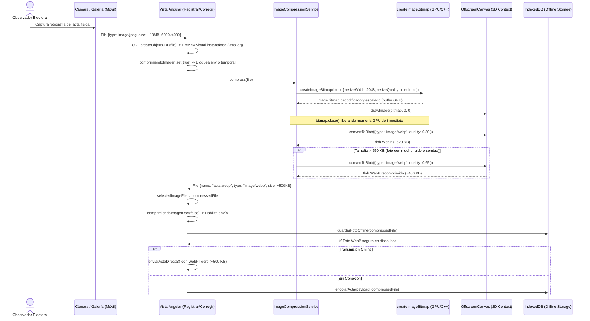

# Flujo 08 — Pipeline de Compresión de Imagen en el Cliente

Escenario: captura de fotografía de alta resolución (celulares modernos 48-108 MP) y compresión adaptativa a WebP 2048px antes de almacenar o transmitir.

