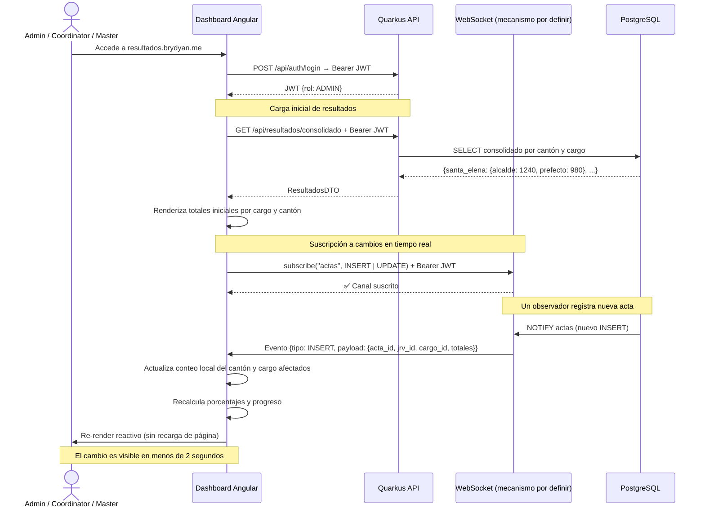

# Flujo 09 — Dashboard: Actualización en Tiempo Real

n**Estado:** ⏳ PLANEADO — Código backend aún no implementado. Ver [diagram/README.md](../README.md).
Escenario: el dashboard recibe y muestra nuevas actas conforme los observadores las registran.

