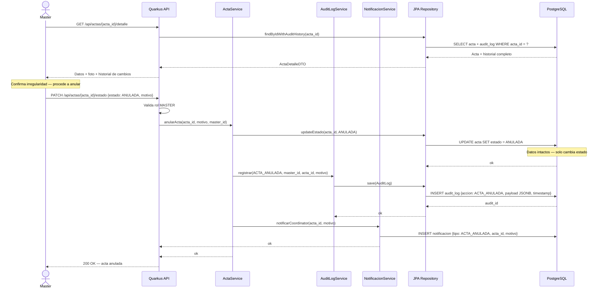

# Flujo 12 — Anulación de Acta por MASTER

n**Estado:** ⏳ PLANEADO — Código backend aún no implementado. Ver [diagram/README.md](../README.md).
---

## Escenario

MASTER detecta fraude o irregularidad grave en acta `APROBADA`. Cambia estado a `ANULADA`. Los datos no se borran — quedan en BD para trazabilidad forense.



---

## Estados del Acta (completo)

```
BORRADOR → ENVIADA → EN_DISPUTA → CORREGIDA → APROBADA → ANULADA
```

| Estado | Quién puede llegar aquí | Reversible |
|--------|------------------------|------------|
| `BORRADOR` | OBSERVER | ✅ |
| `ENVIADA` | OBSERVER | ✅ (si EN_DISPUTA) |
| `EN_DISPUTA` | COORDINATOR / MASTER | ✅ (→ CORREGIDA) |
| `CORREGIDA` | OBSERVER / COORDINATOR | ✅ (→ APROBADA) |
| `APROBADA` | COORDINATOR / MASTER | ⚠️ solo MASTER puede anular |
| `ANULADA` | MASTER | ❌ estado final |

---

## Reglas de Anulación

- Solo MASTER puede ejecutar esta acción.
- `ANULADA` es estado final — no hay transición de salida.
- Datos e historial se conservan íntegros en PostgreSQL.
- Actas `ANULADA` se excluyen de estadísticas comparativas en dashboard.
- COORDINATOR recibe notificación automática al producirse la anulación.

## Notas de Auditoría

| Acción | Quién | payload JSONB contiene |
|--------|-------|------------------------|
| `ACTA_ANULADA` | MASTER | motivo, master_id, estado_anterior: APROBADA |
