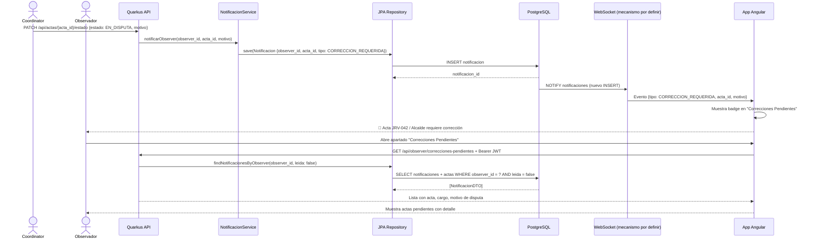
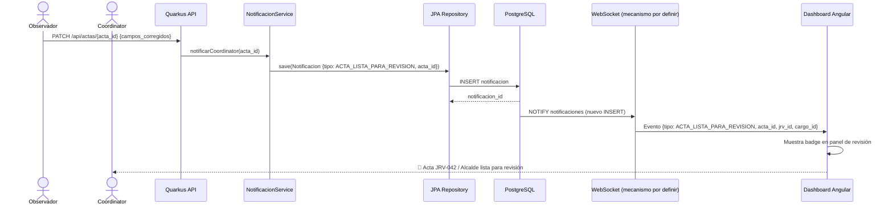
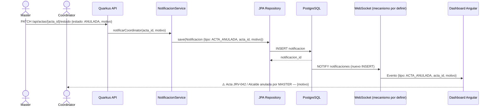
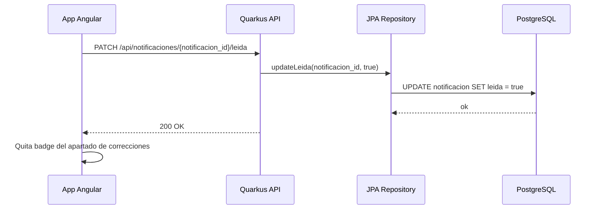

# Flujo 14 — Ciclo de Notificaciones Push

n**Estado:** ⏳ PLANEADO — Código backend aún no implementado. Ver [diagram/README.md](../README.md).
Escenario: ciclo completo desde que se genera un evento hasta que la notificación llega al dispositivo del OBSERVER.

---

## Parte A — Notificación de Corrección al OBSERVER

Escenario: COORDINATOR marca acta EN_DISPUTA → OBSERVER recibe push en su dispositivo.

---

## Parte B — Notificación al COORDINATOR tras Corrección del OBSERVER

Escenario: OBSERVER corrige acta → COORDINATOR es notificado para revisar y aprobar.

---

## Parte C — Notificación de Anulación al COORDINATOR

Escenario: MASTER anula acta APROBADA → COORDINATOR es notificado.

---

## Tipos de Notificación

| Tipo | Receptor | Origen | Canal |
|------|----------|--------|-------|
| `CORRECCION_REQUERIDA` | OBSERVER | COORDINATOR marca EN_DISPUTA | WebSocket (mecanismo por definir) → App móvil |
| `ACTA_LISTA_PARA_REVISION` | COORDINATOR | OBSERVER corrige acta | WebSocket (mecanismo por definir) → Dashboard |
| `ACTA_ANULADA` | COORDINATOR | MASTER anula acta | WebSocket (mecanismo por definir) → Dashboard |

---

## Marcar Notificación como Leída

